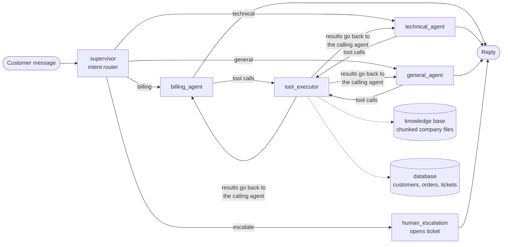

# Multi-Agent Customer Support

A customer support API for AcmeCloud, a fictional software company. A supervisor routes each message to a specialist agent (billing, technical or general). The agents answer from the company's own documents (RAG), look up the customer's records through database tools, and hand anything that needs a person to a human with a ticket. It's built with LangGraph, Groq, FastAPI and SQLAlchemy.



## How it works

- **Routing.** The supervisor sorts the latest message into billing, technical, general or escalate, using recent turns to understand short follow-ups such as "yes, do it". The agent is picked from the intent in code, so the two can't disagree.
- **Knowledge base (RAG).** Every agent can call `search_knowledge_base`, which searches the company files in `knowledge/`. Agents must answer company questions only from what it returns, cite the section in square brackets, and say they don't know when nothing matches. The API returns the sections used in `sources`.
- **Account tools.** Billing can read customer details and order payments and open tickets. Technical can read customer details and open tickets.
- **Customer scoping.** `customer_id` is hidden from the model's tool schema, and the executor fills it in from the request. A customer can only see their own orders, even if a prompt tries to make the model ask for someone else's.
- **Memory.** Each `session_id` keeps its conversation through a LangGraph checkpointer saved to `data/checkpoints.db`, so chats survive server restarts. Sessions are tied to the customer, so reusing a session ID under another customer starts a separate conversation.
- **Escalation.** A request for a human creates an `Escalated` ticket and returns its ID to the customer.

## Setup

```bash
python -m venv venv && source venv/bin/activate   # Windows: venv\Scripts\activate
pip install -r requirements.txt
cp .env.example .env                               # then add your GROQ_API_KEY
python -m scripts.check_connections                # checks the database and Groq
```

`check_connections` should print four `[ok]` lines: database, memory, knowledge and Groq. If the database is empty, either run `python -m app.database.seed` or just start the API; with `SEED_DEMO_DATA=true` it loads the demo data on first start.

## Run

```bash
uvicorn app.main:app --reload
```

- Chat page: http://127.0.0.1:8000
- Interactive API docs: http://127.0.0.1:8000/docs

## Chat page

Open http://127.0.0.1:8000 and chat as a customer. Pick a demo customer at the top (Ali or Sara), then type, or click one of the suggested questions.

- Each reply carries a colored tab for the desk that answered it: green Billing, violet Technical, teal General, amber Support team (human handoff).
- Citations appear as chips inside the reply, and any ticket the agent opened is shown under it.
- The **Behind this reply** panel shows the route: what the router decided and how confident it was, every tool the agent called with its arguments, and the help articles used. Click any earlier reply to see its route.
- Conversations survive page reloads and server restarts. **Start new chat** begins a fresh one.
- On phones the panel opens from the **Details** button.

The page is plain HTML, CSS and JavaScript in `app/static/`, with no build step. Fonts are bundled (`app/static/fonts/`, SIL Open Font License), so it works offline. Set `DEMO_MODE=false` to hide the customer switcher; the page then takes the customer from `?customer=CUS-1001` in the URL until you add a real login.

```bash
curl -X POST http://127.0.0.1:8000/api/v1/chat \
  -H "Content-Type: application/json" \
  -d '{"message": "I was charged twice for order ORD-1034", "customer_id": "CUS-1001"}'
```

The reply includes a `session_id`. Send it back with the next message to continue the same conversation.

| Status | Meaning |
|---|---|
| 200 | Reply generated |
| 404 | Unknown `customer_id` |
| 422 | Invalid body (e.g. missing `customer_id`) |
| 503 | `GROQ_API_KEY` not set |

Other endpoints:

| Endpoint | Purpose |
|---|---|
| `GET /health` | Database, LLM, memory and knowledge base status |
| `GET /api/v1/sessions/{session_id}/messages?customer_id=...` | Earlier messages of a conversation (used to redraw the chat after a reload) |
| `GET /api/v1/demo/customers` | Demo customer list for the switcher (off when `DEMO_MODE=false`) |

Each chat reply also returns `sources` (the document sections it cited) and `tools_used` (every tool call, in order).

Terminal chat that shows routing and tool calls as they happen:

```bash
python -m scripts.chat_cli --customer CUS-1001                 # new conversation
python -m scripts.chat_cli --customer CUS-1001 --session <id>  # resume a saved one
```

## Docker

```bash
docker compose up --build
```

The database and saved conversations live in the `support-data` volume, so they survive `docker compose down` and rebuilds. `docker compose down -v` deletes them.

## How the knowledge base works

```
knowledge/*.md  ->  load + clean  ->  chunk by heading  ->  BM25 index  ->  search_knowledge_base tool
                    documents.py     chunking.py           bm25.py         knowledge_base.py
```

1. **Load.** Each file in `knowledge/` is read, its `title` and `category` taken from the header block at the top, and its whitespace cleaned.
2. **Chunk.** Documents are cut at their headings, so each chunk covers one topic, e.g. `Refund policy > Annual plans`. A section longer than `CHUNK_MAX_CHARS` is split on paragraphs, then lines, then sentences, and each piece repeats the end of the previous one (`CHUNK_OVERLAP`) so no fact is cut in half. Every chunk starts with its `Title > Section` header so it makes sense on its own.
3. **Index.** Chunks are indexed with BM25 keyword ranking. Words are stemmed (refunded, refunds and refund all match), heading words count double, and a small synonym list (`app/rag/synonyms.py`) adds the document's word when a customer uses a different one (yearly becomes annual).
4. **Search.** The agent's query returns the top `RETRIEVAL_TOP_K` chunks. Weak matches under 20% of the best score are dropped.

To add or change company information, edit or add a `.md` file in `knowledge/` and restart the API. Start the file with:

```
---
title: Shipping policy
category: billing
updated: 2026-11-01
---
```

Inspect and measure it:

```bash
python -m scripts.knowledge stats                  # documents and chunk sizes
python -m scripts.knowledge chunks refund-policy   # see exactly how one file was chunked
python -m scripts.knowledge search "money back"    # run a search like the agent does
python -m scripts.knowledge eval                   # retrieval quality on evals/retrieval.jsonl
```

`evals/retrieval.jsonl` holds 38 customer-style questions, each with the sections that correctly answer it. Current scores: the right section is first for 89% of questions and in the top 3 for 100% (MRR 0.94). `tests/test_retrieval_eval.py` fails if a change makes these numbers drop. These questions were written alongside the documents, so real customer wording will score lower; add real questions that fail to the file as you find them.

## Company documents

| File | Covers |
|---|---|
| company-overview.md | What AcmeCloud is, contact channels, support hours, response times, ticket statuses |
| plans-and-pricing.md | Free, Pro, Enterprise features and prices, add-ons, discounts |
| billing-and-payments.md | Payment methods, billing cycle, invoices, failed payments, duplicate charges, taxes |
| refund-policy.md | When refunds are given and how long they take |
| plan-changes-and-cancellation.md | Upgrades, downgrades, cancelling, data after cancelling |
| orders-and-licences.md | Order statuses, activation times, orders with several payments |
| account-and-security.md | Password reset, lockout, 2FA, SSO, roles, account deletion |
| api-guide.md | API keys, rate limits, every error code, webhooks |
| troubleshooting.md | Login, slow app, sync, automations, uploads, maintenance |
| privacy-and-data.md | What is stored, encryption, data region, export, deletion |
| faq.md | Short answers to common questions |

All of it is invented for the demo, and the domains use the reserved `.example` ending.

## Demo data

| Customer | Plan | Order | Notes |
|---|---|---|---|
| CUS-1001 Ali Khan | Pro | ORD-1034 ($149) | Charged twice: TXN-8921 and duplicate TXN-8922 |
| CUS-1002 Sara Ahmed | Enterprise | ORD-1035 ($2,500) | Normal payment |

## Tests

```bash
pytest            # offline: uses a fake LLM, no API key or network needed
pytest -m live    # real Groq calls (needs GROQ_API_KEY)
```

## Configuration

All settings are in `.env.example`. The main ones:

| Variable | Default | |
|---|---|---|
| `GROQ_API_KEY` | none | Required to chat |
| `LLM_MODEL` | `openai/gpt-oss-20b` | Any Groq model with tool calling |
| `DATABASE_URL` | SQLite at `data/support_system.db` | Any SQLAlchemy URL |
| `SEED_DEMO_DATA` | `true` | Load demo rows when the database is empty |
| `MEMORY_BACKEND` | `sqlite` | `sqlite` keeps chats across restarts; `memory` keeps them in RAM only |
| `MEMORY_DB_PATH` | `data/checkpoints.db` | Where saved conversations go |
| `MAX_TOOL_ROUNDS` | `4` | Tool-call rounds per message before the agent must answer with what it has |
| `MAX_GRAPH_STEPS` | `20` | Hard safety limit on graph steps per message |
| `KNOWLEDGE_DIR` | `knowledge/` | Folder of company files |
| `CHUNK_MAX_CHARS` / `CHUNK_OVERLAP` | `1200` / `150` | Chunk size limit and overlap |
| `RETRIEVAL_TOP_K` | `4` | Chunks returned per search |
| `DEMO_MODE` | `true` | Show the demo customer switcher and its endpoint |
| `CORS_ORIGINS` | none | Comma-separated origins allowed to call the API from another domain |

## Project layout

```
app/
  config.py            settings from env / .env
  llm.py               lazy Groq client
  memory.py            conversation memory (SQLite checkpointer)
  main.py              FastAPI app (API + chat page)
  static/              chat page: index.html, styles.css, app.js, fonts/
  database/
    connection.py      engine, session_scope, init_db, check_db
    models.py          Customer, Order, Payment, SupportTicket
    seed.py            demo data
  rag/
    documents.py       load + clean company files
    chunking.py        heading-aware chunking with overlap
    bm25.py            keyword ranking
    synonyms.py        query expansion list
    knowledge_base.py  index + search
    evaluation.py      hit@k / MRR metrics
  graph/
    workflow.py        graph wiring, tool executor, escalation node
    router.py          supervisor (structured output)
    agents.py          specialist prompts and tool lists
    history.py         conversation slicing helpers
    state.py           SupportState
  tools/
    db_tools.py        database tools
    knowledge_tools.py search_knowledge_base (RAG tool)
knowledge/             company files (the RAG source)
evals/                 retrieval test questions
scripts/               check_connections, chat_cli, knowledge
tests/                 offline suite + live tests
```
