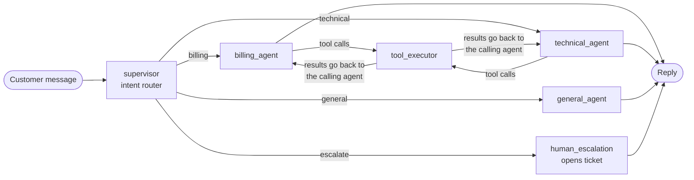

# Multi-Agent Customer Support

A customer support API where a supervisor routes each message to a specialist agent (billing, technical or general). The agents look up real records through database tools, and anything that needs a person goes to a human with a ticket. It's built with LangGraph, Groq, FastAPI and SQLAlchemy.



## How it works

- **Routing.** The supervisor sorts the latest message into billing, technical, general or escalate, using recent turns to understand short follow-ups such as "yes, do it". The agent is picked from the intent in code, so the two can't disagree.
- **Tools.** Billing can read customer details and order payments and open tickets. Technical can read customer details and open tickets. General has no tools.
- **Customer scoping.** `customer_id` is hidden from the model's tool schema, and the executor fills it in from the request. A customer can only see their own orders, even if a prompt tries to make the model ask for someone else's.
- **Memory.** Each `session_id` keeps its conversation through a LangGraph checkpointer. Sessions are tied to the customer, so reusing a session ID under another customer starts a separate conversation.
- **Escalation.** A request for a human creates an `Escalated` ticket and returns its ID to the customer.

## Setup

```bash
python -m venv venv && source venv/bin/activate   # Windows: venv\Scripts\activate
pip install -r requirements.txt
cp .env.example .env                               # then add your GROQ_API_KEY
python -m scripts.check_connections                # checks the database and Groq
```

`check_connections` should print two `[ok]` lines. If the database is empty, either run `python -m app.database.seed` or just start the API; with `SEED_DEMO_DATA=true` it loads the demo data on first start.

## Run

```bash
uvicorn app.main:app --reload
```

Interactive docs: http://127.0.0.1:8000/docs

```bash
curl -X POST http://127.0.0.1:8000/api/v1/chat \
  -H "Content-Type: application/json" \
  -d '{"message": "I was charged twice for order ORD-1034", "customer_id": "CUS-1001"}'
```

The reply includes a `session_id`. Send it back with the next message to continue the same conversation.

| Status | Meaning |
|---|---|
| 200 | Reply generated |
| 404 | Unknown `customer_id` |
| 422 | Invalid body (e.g. missing `customer_id`) |
| 503 | `GROQ_API_KEY` not set |

`GET /health` reports the database and LLM configuration.

Terminal chat that shows routing and tool calls as they happen:

```bash
python -m scripts.chat_cli --customer CUS-1001
```

## Demo data

| Customer | Plan | Order | Notes |
|---|---|---|---|
| CUS-1001 Ali Khan | Pro | ORD-1034 ($149) | Charged twice: TXN-8921 and duplicate TXN-8922 |
| CUS-1002 Sara Ahmed | Enterprise | ORD-1035 ($2,500) | Normal payment |

## Tests

```bash
pytest            # offline: uses a fake LLM, no API key or network needed
pytest -m live    # real Groq calls (needs GROQ_API_KEY)
```

## Configuration

All settings are in `.env.example`. The main ones:

| Variable | Default | |
|---|---|---|
| `GROQ_API_KEY` | none | Required to chat |
| `LLM_MODEL` | `openai/gpt-oss-20b` | Any Groq model with tool calling |
| `DATABASE_URL` | SQLite at `data/support_system.db` | Any SQLAlchemy URL |
| `SEED_DEMO_DATA` | `true` | Load demo rows when the database is empty |
| `MAX_GRAPH_STEPS` | `12` | Stops runaway tool loops |

## Project layout

```
app/
  config.py            settings from env / .env
  llm.py               lazy Groq client
  main.py              FastAPI app
  database/
    connection.py      engine, session_scope, init_db, check_db
    models.py          Customer, Order, Payment, SupportTicket
    seed.py            demo data
  graph/
    workflow.py        graph wiring, tool executor, escalation node
    router.py          supervisor (structured output)
    agents.py          specialist prompts and tool lists
    history.py         conversation slicing helpers
    state.py           SupportState
  tools/db_tools.py    database tools
scripts/               check_connections, chat_cli
tests/                 offline suite + live tests
```
